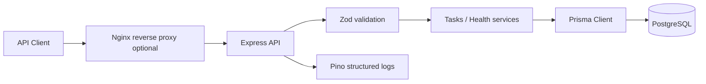

# Architecture

## System components

| Component | Responsibility |
|-----------|----------------|
| `src/server.ts` | Process entrypoint, HTTP listen, graceful shutdown |
| `src/app.ts` | Express middleware stack and route mounting |
| `src/config` | Environment validation at startup |
| `src/routes` | URL → controller wiring |
| `src/controllers` | HTTP request/response mapping |
| `src/services` | Business logic and Prisma access |
| `src/schemas` | Zod request validation |
| `src/middleware` | Validation helpers, 404, centralized errors |
| `src/lib` | Logger, Prisma client, error types |
| PostgreSQL | Persistent task storage |
| Docker Compose | Local multi-container runtime |
| GitHub Actions | CI checks (no auto-deploy in initial phase) |

## Data flow

1. Client sends HTTP request.
2. Helmet/CORS/body parsing run.
3. Request logger records method/url/status (sensitive fields redacted).
4. Route-level Zod validation rejects invalid input with `400`.
5. Controller delegates to service.
6. Service uses Prisma (parameterized) against PostgreSQL.
7. Response uses consistent JSON envelopes; errors use `{ error: { code, message, details? } }`.

## Database design

**Table:** `tasks`

| Column | Type | Notes |
|--------|------|-------|
| `id` | UUID | Primary key, generated |
| `title` | VARCHAR(200) | Required |
| `description` | TEXT | Optional |
| `status` | ENUM(`TODO`, `IN_PROGRESS`, `DONE`) | Default `TODO` |
| `created_at` | TIMESTAMP | Set on create |
| `updated_at` | TIMESTAMP | Maintained by Prisma `@updatedAt` |

Indexes: `status`, `created_at`.

## Mermaid diagram

## Security boundaries

- Public HTTP surface is limited to health and `/api/v1/tasks` routes.
- No credentials are returned by the API.
- Database credentials live only in environment variables / Compose secrets for local demo.
- Production OCI guidance: expose only 80/443 publicly; keep SSH restricted; never open Postgres to the internet.
- Stack traces are logged server-side; production clients receive generic 500 messages.
